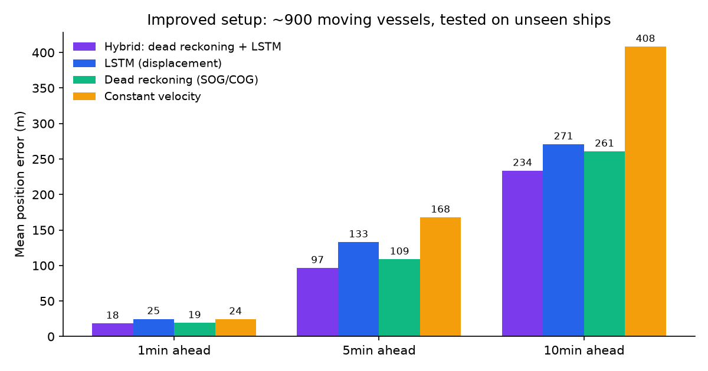

# Vessel Trajectory Prediction with LSTMs on AIS Data

Predicting where a ship will be in 1, 5 and 10 minutes, using 15 million raw AIS
messages from the Danish Maritime Authority.

This started as my BSc thesis at the **University of Piraeus** (Department of
Digital Systems, April 2025). The thesis reported an LSTM with **R² = 0.999**.
In November 2026 I revisited it with an AI coding assistant, which found that
number was misleading and rebuilt the evaluation and the model. This repo has
both, kept clearly apart:

- **My thesis work:** [`thesis/original_thesis_notebook.ipynb`](thesis/original_thesis_notebook.ipynb):
  data preparation, exploratory analysis and the LSTM, written by me.
- **Follow-up analysis:** everything under `src/` and `scripts/`, the baselines,
  the multi-vessel and hybrid models, and the results below, written with
  [Claude Code](https://claude.com/claude-code) in November 2026.



## Key results

**1. The thesis metric was misleading.** The original experiment was re-run and
compared with two baselines that need no training:

| 1 minute ahead (thesis vessel) | R² | Mean error |
|---|---|---|
| Thesis LSTM | 0.9988 | 575 m |
| "The ship stays where it is" | 0.9996 | 245 m |
| "The ship repeats its last step" | 0.99998 | **36 m** |

R² on raw latitude/longitude is close to 1 for almost any prediction, because
positions change very little from one minute to the next. Errors in meters show
the real picture: the LSTM was much worse than simple physics. The single test
vessel (a ferry) and about 1,100 training samples were too little for it to
learn anything useful.

**2. A hybrid model beats physics.** The thesis proposed hybrid models as future
work, and the follow-up built one. Dead reckoning (projecting the last reported speed and
course forward) makes the prediction, and an LSTM learns to correct it. It was
trained on about 900 moving vessels and tested on ships it never saw during training.

| Mean error (median) | 1 min | 5 min | 10 min |
|---|---|---|---|
| **Hybrid: dead reckoning + LSTM** | **18.4 m** (6.3) | **96.6 m** (33.7) | **233.7 m** (91.3) |
| LSTM alone | 24.8 m (12.7) | 133.0 m (67.2) | 270.9 m (122.3) |
| Dead reckoning (speed + course) | 19.1 m (5.9) | 108.7 m (37.3) | 260.9 m (84.1) |
| Constant velocity | 24.5 m (6.7) | 167.9 m (50.3) | 408.4 m (115.7) |
| Stays where it is | 214.7 m (224.6) | 1,243 m (1,398) | 2,377 m (2,686) |

The hybrid lowers the mean error by 4–11% against dead reckoning and has
fewer large misses: 90% of 10-minute predictions are within 598 m, against
728 m for dead reckoning. Its median is slightly worse at 1 and 10 minutes, so
the gain comes from handling turns and speed changes, not from the
straight-line cases physics already gets right.

## What changed from the thesis

| | Thesis (2025) | This version |
|---|---|---|
| Vessels | 1 (most messages) | about 900 moving vessels |
| Missing values | dropped every incomplete row (87% of data) | kept; speed/course filled from the track |
| Gaps in reporting | interpolated straight through | track split into segments |
| Test set | last 20% of the same ship's day | ships never seen in training |
| Target | absolute latitude/longitude | displacement in meters |
| Metric | MSE / MAE / R² in degrees | error in meters, vs. 3 baselines |

## Project structure

```
├── scripts/download_data.py     # fetches the public DMA AIS file for one day
├── src/ais_traj/
│   ├── data.py                  # cleaning, segmentation, resampling
│   ├── models.py                # thesis LSTM, displacement LSTM, baselines
│   ├── reproduce.py             # step 1: re-run the thesis + baselines
│   ├── experiment.py            # step 2: multi-vessel and hybrid models
│   └── plots.py                 # figures in this README
├── results/                     # metrics produced by the scripts
├── figures/
└── thesis/original_thesis_notebook.ipynb   # the code submitted with the thesis
```

## Run it

Requires Python 3.10–3.12. An NVIDIA GPU is optional; everything also runs on CPU.

```bash
git clone https://github.com/kounikos/ais-trajectory-lstm
cd ais-trajectory-lstm
python -m venv .venv && source .venv/bin/activate
pip install -e .            # or: pip install -e ".[gpu]"

python scripts/download_data.py      # ~540 MB download, ~2.8 GB CSV
python -m ais_traj.reproduce         # thesis reproduction, a few minutes
python -m ais_traj.experiment        # multi-vessel + hybrid models
python -m ais_traj.plots
```

## Data

[Danish Maritime Authority AIS data](http://aisdata.ais.dk/), 21 February 2025:
15.4 million messages, of which 8.4 million are valid Class A position reports
from 2,064 vessels. AIS is the radio system ships use to broadcast their
position, speed and course every few seconds.

## Limitations and next steps

- One day of data and one random train/test split of vessels. More days and
  several splits would give confidence intervals for the gains above.
- Only next-step prediction. Predicting a full path several steps ahead is the
  more useful (and harder) problem.
- Weather, currents and port locations are not used. The thesis lists them as
  future work, and they are the most likely way to improve on turns.

## Thesis

*Πρόβλεψη Τροχιών Πλοίων με Χρήση Δικτύων LSTM: Μια Προσέγγιση Μηχανικής
Μάθησης με Αξιοποίηση Δεδομένων AIS της Δανικής Αρχής Ναυτιλίας*
("Vessel Trajectory Prediction Using LSTM Networks with Danish Maritime
Authority AIS Data"). Nikolaos Kountouriotis, University of Piraeus, April 2025.
Supervisor: Christos Doulkeridis, Associate Professor.
